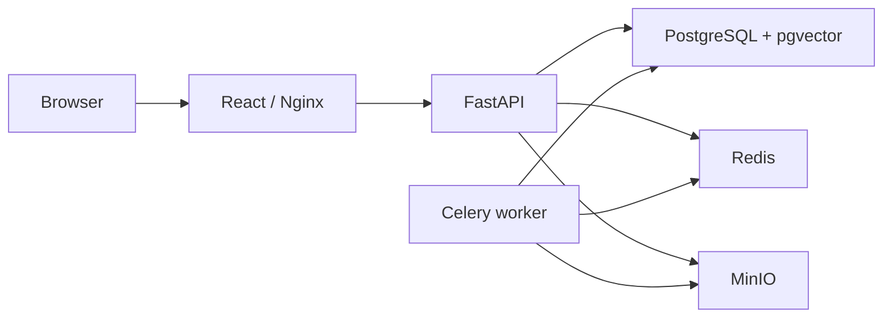

# Architecture

AtlasIQ starts as a modular monolith with an independently scalable Celery worker.
The API will own authentication and authorized domain operations. CPU-intensive parsing,
embeddings and evaluations will run in the worker. PostgreSQL is the authoritative store;
Redis is a broker and MinIO is private object storage in development.

This is the intended service topology, not a claim that domain workflows exist.
Phase 0 validates infrastructure connectivity only. No upload/query route is registered.
The initial migration installs vector and pgcrypto. Domain tables and invariant constraints
will arrive with versioned migrations starting in Phase 1.

Tests are split between isolated API/configuration tests and integration tests requiring
the real stack. Integration tests must never replace PostgreSQL with SQLite or storage
with an in-memory stand-in. Provider fakes will live only in tests when model adapters arrive.
